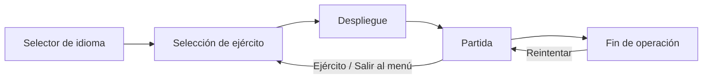

# Arquitectura de Frente Global

Documento técnico de la estructura del juego, sus sistemas principales y los puntos que hay que tocar para ampliarlo.

## 1. Visión general

Frente Global es un tower defense táctico en 3D que funciona como sitio estático y como PWA instalable. No hay bundler, framework ni paso de compilación: el navegador carga directamente `index.html`, `game.js` y la copia local de Three.js.

```
index.html ──► UI, estilos, pantallas y atributos de traducción
game.js    ──► motor completo: datos, escena, simulación, UI dinámica e i18n
sw.js      ──► caché offline y actualización por build
manifest   ──► instalación PWA, iconos y orientación
vendor/    ──► Three.js r128 vendorizado
docs/      ──► documentación técnica
```

### Flujo de entrada



Al abrir la aplicación siempre aparece `#languageScreen` con las banderas de España y Estados Unidos. La elección se guarda en `localStorage` y se aplica a toda la interfaz antes de mostrar la selección de ejército. Desde Ajustes se puede cambiar el idioma en cualquier momento, incluso en mitad de una partida.

## 2. Archivos y responsabilidades

| Archivo | Responsabilidad |
| --- | --- |
| `index.html` | Documento único de entrada. Contiene el canvas, el HUD, las pantallas superpuestas (idioma, ejército, pausa, derrota, ajustes) y todo el CSS responsive. Los textos estáticos llevan `data-i18n`, `data-i18n-html` o `data-i18n-title`. |
| `game.js` | Script clásico en modo estricto. Declara datos, helpers, renderizado, simulación, modelos procedurales, sonido, persistencia, i18n y eventos. |
| `sw.js` | Service worker. Navegación red-primero; recursos estáticos caché-primero con revalidación. `__BUILD__` se sustituye por el SHA del commit en el workflow. |
| `manifest.webmanifest` | Metadatos PWA: nombre, iconos, orientación horizontal, colores y modo `standalone`. |
| `vendor/three.min.js` | Three.js r128 local para que el juego no dependa de CDN. |
| `icons/` | Iconos PWA de 192, 512, maskable y Apple Touch. |
| `.github/workflows/deploy.yml` | Publica el sitio en GitHub Pages en cada push a `main` o por ejecución manual. |

## 3. Datos del juego

Los datos viven al principio de `game.js` y son estructuras planas fáciles de editar.

### Ejércitos (`ARMIES`)

Ocho facciones con:

- `id`, `name`, `nameEn`, `flag`.
- `bonus` / `bonusEn`: modificador visible en la tarjeta.
- `weapons` / `weaponsEn`: dotación mostrada en el menú.
- `cash`: créditos iniciales.
- `mults`: multiplicadores por tipo de torre.
- `kit`: variante visual usada por los modelos procedurales.
- `discount`: descuento opcional en torres (China).

La facción activa se guarda en `state.army` y su índice en `settings.army`.

### Equipo por país (`WEAPONS`)

Asocia cada ejército y tipo de torre con un nombre real de equipo. `WEAPONS_EN` contiene las excepciones que cambian en inglés (por ejemplo, «Cúpula de Hierro» → «Iron Dome» y «Brouilleur» → «Jammer»). La función `armyWeapon(type)` resuelve el nombre correcto según el idioma.

### Torres (`TOWERS`)

Nueve sistemas, siete terrestres y dos navales:

```text
gun · mortar · art · rocket · aa · laser · ew · destroyer · carrier
```

Campos principales:

- `name` / `nameEn`, `desc` / `descEn`, `icon`.
- `cost`, `range`, `damage`, `rate`, `targets`.
- `splash`, `pierce`, `slow`, `salvo` (opcionales).
- `domain`: `land` o `sea`.

`getCost(type)` aplica el descuento del ejército. `validPlacement()` decide si una celda es válida.

### Enemigos (`ENEMIES`)

Tipos de tierra y aire con HP, velocidad, recompensa, radio, color, daño, blindaje, nivel (`tier`) e icono. Los enemigos desbloqueados por oleada se definen en:

```js
const WAVE_UNLOCK = { apc: 3, heli: 4, tank: 5, drone: 6, mlrs: 7, fighter: 9, bomber: 11 };
const WAVE_WEIGHT = { ... };
```

`buildWavePlan(wave)` genera una composición determinista; `waveScalars(wave)` escala HP, daño y velocidad; `threatKey()` / `threatLevel()` calculan el nivel de amenaza.

### Rutas (`ROUTES`, `AIR_ROUTE`)

Dos rutas terrestres quebradas (`main` y `bypass`) y un corredor aéreo. Cada ruta es una lista de puntos `[x, z]`; `routeLength()` precarga su longitud para calcular el progreso de cada enemigo.

### Estado (`state`)

Objeto central de la simulación:

- Partida: `wave`, `cash`, `hp`, `score`, `active`, `paused`, `gameOver`, `deployed`, `speed`.
- Entidades: `enemies`, `towers`, `effects`, `spawnQueue`.
- Interacción: `selectedTower`, `buildType`, `abilityMode`, `selectedArmy`.
- Habilidades: `strike`, `emp`, `repair`, con coste, recarga y cooldown.
- Intel: `currentPlan`, `waveIntel`.

### Persistencia

```text
frente-global:settings:v1  → calidad, sonido, volumen, ejército, etiquetas, idioma
frente-global:records:v1   → mejor oleada, récord, partidas
```

`loadStore()` mezcla los valores guardados con los predeterminados y tolera JSON corrupto.

## 4. Internacionalización

El juego está completamente disponible en español e inglés.

### Diccionario y helpers

- `I18N.es` / `I18N.en`: diccionario plano de claves → texto.
- `tr(key, vars)`: devuelve el texto del idioma activo y sustituye placeholders `{nombre}`.
- `loc(obj, field)`: devuelve `obj[field + 'En']` cuando el idioma es inglés y existe; si no, `obj[field]`.

Los datos bilingües usan sufijos `En`: `nameEn`, `bonusEn`, `weaponsEn`, `descEn`, `perkEn`.

### Textos estáticos

En `index.html`:

```html
<div class="label" data-i18n="stat.credits">Créditos</div>
<div class="shortcuts" data-i18n-html="settings.shortcutsHtml">...</div>
<button data-i18n-title="action.settings" title="Ajustes">⚙</button>
```

`applyLanguage()` recorre esos atributos y actualiza `textContent`, `innerHTML` o `title`.

### Textos dinámicos

Toda la UI generada por JavaScript usa `tr()` y `loc()`:

- Tarjetas de torre, inspección, intel de oleada y barra de habilidades.
- Avisos (`toast`), pantalla de derrota, récords y ajustes.
- Etiquetas 3D de enemigos y rangos (`VETERANO` / `VETERAN`, `ÉLITE` / `ELITE`).

Al cambiar de idioma, `refreshEnemyLabels()` reconstruye los sprites de texto de los enemigos que ya están en el mapa. Los proyectiles y modelos no se recrean.

### Cambio de idioma

- Selector inicial: botones `.language-option[data-lang]`.
- Ajustes: `#languageSelect`.
- `setLanguage(lang)` guarda la preferencia, aplica la traducción y actualiza `<html lang>`, título y meta descripción.
- La pantalla de idioma se muestra en cada carga completa; la elección previa solo determina el idioma de los textos de esa pantalla.

## 5. Renderizado y mundo 3D

### Base técnica

- `THREE.WebGLRenderer` con antialias, sombras PCF suaves, tone mapping ACES y pixel ratio limitado por calidad.
- Escena con cielo/fog, luz hemisférica, sol direccional con sombras y luz de borde.
- Cámara en perspectiva con `yaw`, distancia y objetivo; controles de órbita, paneo, zoom y pellizco.

### Calidad gráfica

`QUALITY_PRESETS` define píxel ratio, sombras y partículas:

- `high`, `medium`, `low`.
- `auto` elige `medium` en punteros táctiles y `high` en escritorio.
- Si el frame rate cae de forma sostenida, el modo automático baja un nivel y avisa al jugador.

### Mundo y celdas

- El mapa mide `30 × 18` celdas.
- `world` es el grupo raíz de la escena.
- `towerCells` evita solapamientos; `gridCells` marca celdas ocupadas por decoración.
- `validPlacement()` comprueba límites, agua, caminos, base y celdas libres.
- Las naves solo pueden colocarse en las dos filas centrales de agua para que el casco no sobresalga de la costa.

### Modelos procedurales

No hay assets externos. `buildTowerModel()` y `enemyModel()` construyen cada unidad con geometrías y materiales cacheados (`geoCache`, `matCache`). Los modelos tienen `userData` con piezas animables: torreta, cañones, rotores, orugas, etiqueta y barra de vida.

## 6. Simulación y combate

### Bucle principal

`tick(now)` se ejecuta con `requestAnimationFrame` y calcula un `dt` acotado a 50 ms. La simulación avanza solo si hay partida desplegada, no está pausada, no ha terminado y la pestaña está visible. La velocidad de juego (`×1`, `×2`, `×3`) multiplica el delta de simulación.

Orden aproximado por frame:

1. Cámara y controles.
2. Spawn de enemigos.
3. Movimiento de enemigos.
4. Disparo y actualización de torres.
5. Proyectiles, explosiones y efectos.
6. Recargas de habilidades.
7. HUD e intel (cada N frames).
8. Render.

### Torres y proyectiles

Cada torre combina sus estadísticas base con los multiplicadores del ejército. Al mejorar:

- Daño ×1.34.
- Alcance ×1.07.
- Cadencia ×0.94.

Los tipos de ataque son:

- Balas instantáneas o trazadoras.
- Mortero/artillería con proyectil parabólico y daño en área.
- Salvas de cohetes.
- Misiles guiados antiaéreos.
- Láser continuo con penetración total.
- Pulso EW que ralentiza.
- Misiles de crucero navales.
- Ataque aéreo embarcado del portaaviones.

### Prioridades de fuego

Cada torre puede alternar entre:

```text
first · last · strong · close
```

La prioridad se guarda en `tower.mode` y se muestra en el panel de inspección.

### Rangos y dificultad

A partir de ciertas oleadas aparecen enemigos veteranos y de élite, con más HP, daño y recompensa. Los jefes aparecen cada cinco oleadas. El daño recibido por la base depende del tipo de enemigo que alcanza el final de la ruta.

### Habilidades de mando

| Habilidad | Tecla | Coste | Efecto |
| --- | --- | --- | --- |
| Ataque aéreo | `Z` | 120 | Daño elevado en área sobre un punto elegido. |
| Pulso EMP | `X` | 90 | Ralentiza a todos los enemigos durante 4,5 s. |
| Reparar base | `C` | 80 | Recupera hasta 22% de integridad. |

### Oleadas

- `makeWave()` incrementa la oleada, construye el plan y llena la cola de spawn.
- Al limpiar una oleada se concede una bonificación y se actualizan los récords.
- `renderIntel()` muestra la composición prevista o en curso, el escalado y la amenaza.

## 7. Interfaz

### HUD superior

Muestra facción, créditos, integridad, oleada, enemigos y amenaza. Los botones permiten cambiar de ejército, centrar cámara, sonido, pausa, pantalla completa y ajustes.

### Paneles laterales

- **Arsenal:** tarjetas de torre con coste, dominio y descripción; teclas `1`–`9`.
- **Inspección / Intel:** si no hay torre seleccionada muestra la previsión de oleada; si hay torre seleccionada muestra daño, alcance, cadencia, prioridad, mejora y venta.

### Pantallas superpuestas

- `#languageScreen`: selector inicial bilingüe.
- `#armyScreen`: selección de facción y despliegue.
- `#pauseScreen`: reanudar, ajustes o salir al menú.
- `#defeatScreen`: resultado, récords y reintento.
- `#settingsScreen`: idioma, calidad, sonido, etiquetas, volumen, pantalla completa, instalación y borrado de progreso.
- `#updateBanner`: aviso de nueva versión del service worker.

### Responsive

- Escritorio: tres columnas con paneles laterales.
- Tablet: paneles más estrechos.
- Móvil vertical: arsenal en bandeja horizontal inferior, inspección flotante, barra de habilidades compacta y botones táctiles de al menos 38–46 px.
- Se respetan `safe-area-inset-*` y `prefers-reduced-motion`.

## 8. Audio

`Sound` es un módulo IIFE basado en Web Audio. Sintetiza disparos, explosiones, pasos de oleada, mejoras y errores con osciladores y ruido filtrado. No descarga archivos. Incluye puertas de frecuencia para evitar saturación y respeta el volumen y el silencio guardados.

## 9. PWA, caché y despliegue

### Service worker

- `install`: precarga el shell (`index.html`, `game.js`, manifiesto, Three.js e iconos) y activa de inmediato.
- `activate`: elimina cachés antiguas.
- `fetch`:
  - Navegación: red primero con respaldo en caché.
  - Estáticos: caché primero y actualización en segundo plano.
- El workflow sustituye `__BUILD__` por el SHA del commit, de modo que cada despliegue invalida la caché.

### GitHub Pages

El workflow `.github/workflows/deploy.yml` se dispara con push a `main` o manualmente. Configura Pages, empaqueta la raíz del repositorio y publica con `actions/deploy-pages`. El grupo de concurrencia `pages` cancela ejecuciones antiguas.

## 10. Cómo ampliar el juego

### Añadir una torre

1. Añade la entrada a `TOWERS` con `name` / `nameEn`, `desc` / `descEn`, coste, estadísticas, dominio y opcionales.
2. Si necesita un nombre real por país, añádelo a `WEAPONS` y, si cambia en inglés, a `WEAPONS_EN`.
3. Añade su modelo en `buildTowerModel()` o reutiliza un `kit` existente.
4. Añade el comportamiento de disparo en `fire()` y las estadísticas dentro de `updateTowers()`.
5. Comprueba que el orden de `TOWERS` sigue cuadrando con las teclas `1`–`9`.
6. Añade las claves de texto nuevas a `I18N.es` e `I18N.en`.

### Añadir un enemigo

1. Añade la entrada a `ENEMIES` con datos bilingües.
2. Defínelo en `WAVE_UNLOCK`, `WAVE_WEIGHT` y, si es aéreo, en `ALTITUDE`.
3. Añade su modelo en `enemyModel()` y sus animaciones en `updateEnemy()`.
4. Revisa el icono, el `tier` y el blindaje para el panel de intel.

### Añadir un ejército

1. Añade la facción a `ARMIES` con datos bilingües, multiplicadores y `kit`.
2. Añade su equipo a `WEAPONS`.
3. Añade el color y la bandera.
4. Verifica que `kit` usa variantes existentes en `buildTowerModel()`.

### Añadir una cadena de UI

1. Usa `data-i18n` en HTML estático o `tr('clave')` en JavaScript.
2. Añade la clave a ambos idiomas.
3. Si contiene HTML, usa `data-i18n-html` y una clave terminada en `Html`.

## 11. Comprobaciones rápidas

```bash
# Servir en local
python3 -m http.server 4173

# Validar sintaxis del motor
node --check game.js
```

Checklist manual:

- El selector de idioma aparece al cargar y muestra ambas banderas.
- Al elegir idioma se muestra la selección de ejército en ese idioma.
- Ajustes → Idioma cambia la UI al instante y persiste tras recargar.
- Las etiquetas 3D de enemigos cambian de idioma sin errores.
- Construcción, mejora, venta, habilidades, oleadas y derrota muestran textos correctos.
- En móvil vertical no hay solapamientos entre arsenal, habilidades y avisos.
- La consola no muestra errores y el service worker sirve la versión nueva tras el despliegue.
