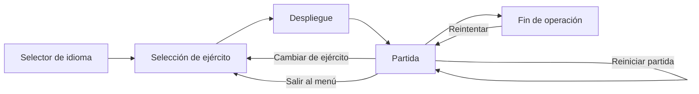

# Arquitectura de Frente Global

Documento técnico de la estructura del juego, sus sistemas principales y los puntos que hay que tocar para ampliarlo.

## 1. Visión general

Frente Global es un tower defense táctico en 3D que funciona como sitio estático y como PWA instalable. No hay bundler, framework ni paso de compilación: el navegador carga directamente `index.html`, `game.js` y la copia local de Three.js.

```
index.html ──► UI, estilos, pantallas y atributos de traducción
game.js    ──► motor completo: datos, escena, simulación, UI dinámica e i18n
sw.js      ──► caché offline y actualización por build
manifest   ──► instalación PWA, iconos y orientación
vendor/    ──► Three.js r128 vendorizado
docs/      ──► documentación técnica
```

### Flujo de entrada



Al abrir la aplicación siempre aparece `#languageScreen` con las banderas de España y Estados Unidos. La elección se guarda en `localStorage` y se aplica a toda la interfaz antes de mostrar la selección de ejército. Desde Ajustes se puede cambiar el idioma en cualquier momento, incluso en mitad de una partida.

## 2. Archivos y responsabilidades

| Archivo | Responsabilidad |
| --- | --- |
| `index.html` | Documento único de entrada. Contiene el canvas, el HUD, las pantallas superpuestas (idioma, ejército, pausa, derrota, ajustes) y todo el CSS responsive. Los textos estáticos llevan `data-i18n`, `data-i18n-html` o `data-i18n-title`. |
| `game.js` | Script clásico en modo estricto. Declara datos, helpers, renderizado, simulación, modelos procedurales, sonido, persistencia, i18n y eventos. |
| `sw.js` | Service worker. Navegación red-primero; recursos estáticos caché-primero con revalidación. `__BUILD__` se sustituye por el SHA del commit en el workflow. |
| `manifest.webmanifest` | Metadatos PWA: nombre, iconos, orientación horizontal, colores y modo `standalone`. |
| `vendor/three.min.js` | Three.js r128 local para que el juego no dependa de CDN. |
| `icons/` | Iconos PWA de 192, 512, maskable y Apple Touch. |
| `.github/workflows/deploy.yml` | Publica el sitio en GitHub Pages en cada push a `main` o por ejecución manual. |

## 3. Datos del juego

Los datos viven al principio de `game.js` y son estructuras planas fáciles de editar.

### Ejércitos (`ARMIES`)

Ocho facciones con:

- `id`, `name`, `nameEn`, `flag`.
- `bonus` / `bonusEn`: modificador visible en la tarjeta.
- `weapons` / `weaponsEn`: dotación mostrada en el menú.
- `cash`: créditos iniciales.
- `mults`: multiplicadores por tipo de torre. `armyMods()` los convierte en daño, alcance y cadencia finales.
- `kit`: variante visual usada por los modelos procedurales.
- `discount`: descuento opcional en torres (China).

La facción activa se guarda en `state.army` y su índice en `settings.army`. Al desplegar una facción distinta a la partida en curso, `deploy()` llama a `resetGame()` y comienza un enfrentamiento nuevo.

### Equipo por país (`WEAPONS`)

Asocia cada ejército y tipo de torre con un nombre real de equipo. `WEAPONS_EN` contiene las excepciones que cambian en inglés (por ejemplo, «Cúpula de Hierro» → «Iron Dome» y «Brouilleur» → «Jammer»). La función `armyWeapon(type)` resuelve el nombre correcto según el idioma.

### Torres (`TOWERS`)

Nueve sistemas, siete terrestres y dos navales:

```text
gun · mortar · art · rocket · aa · laser · ew · destroyer · carrier
```

Campos principales:

- `name` / `nameEn`, `desc` / `descEn`, `icon`.
- `cost`, `range`, `damage`, `rate`, `targets`.
- `splash`, `pierce`, `slow`, `salvo` (opcionales).
- `domain`: `land` o `sea`.

`getCost(type)` aplica el descuento del ejército y la inflación de construcción. `towerCostInflation()` combina tres factores: +3 % por cada estructura desplegada después de las dos primeras, +8 % por cada torre repetida del mismo tipo a partir de la segunda, y hasta +85 % según la oleada. El resultado se interpola con un peso (`weight`) para que `upgradeCost()` sufra la misma inflación a la mitad. `sellValue()` devuelve el 50 % de `tower.invested`, que acumula el coste real de construcción y de cada mejora, no el coste base. Cada torre tiene una huella: las terrestres ocupan `1×1` y los cascos navales `2×2`. `footprintOf()`, `footprintCells()` y `validPlacement()` comprueban todas las celdas de la huella (límites, agua, pista, base y ocupación) antes de construir o vender.

### Enemigos (`ENEMY_FACTIONS`, `ENEMIES`)

`ENEMY_FACTIONS` agrupa diez facciones: cavernícolas, espartanos, cruzados, piratas, la Gran Guerra, tecnología china, zombis, alienígenas, demonios y celestiales. Cada facción declara:

- `units`: tropas disponibles, con `kind` `ground` o `air`, HP, velocidad, recompensa, radio, color, daño, blindaje, nivel (`tier`) e icono.
- `boss`: jefe de facción con `structureDamage`, cupo de asedio y recompensa alta.
- `climate` / `tempC` / `tempF`: clima y temperatura que imponen al frente.
- `flag` y color de facción.

`ENEMIES` es el índice plano de todas las unidades; `enemyFaction(type)` recupera su facción y cada entrada recibe un `jam` entre 0 y 1. `JAM_BY_FACTION` define la vulnerabilidad base de la facción y `JAM_OVERRIDES` la ajusta por unidad: criaturas, magia, pegasos, pterodáctilos y aviación sin guiado electrónico son inmunes; drones, cibertropas, cazas y naves alienígenas son totalmente vulnerables. `jamFactor(e)` normaliza el valor y lo usan EW, EMP e intel.

Cada facción ocupa `WAVES_PER_FACTION = 4` oleadas normales y cierra con su jefe (`FACTION_CYCLE = 5`), de modo que la rotación completa de las diez facciones dura 50 oleadas. `factionByWave()`, `waveInFaction()`, `isBossWave()` y `wavesUntilBoss()` resuelven el ciclo.

`BOSS_SKILLS` define las habilidades de estructura y `BOSS_SKILL_BY_ID` asigna una a cada jefe: `smash` (golpe sísmico), `siege` (asedio), `sabotage` y `abduct` (destrucción completa), `barrage` (aturdimiento amplio), `emp` (apagón masivo), `inferno` (degradación y destrucción de niveles bajos) y `judgment` (degradación e inhabilitación sectorial). Cada habilidad declara `cooldown`, `maxTargets`, `radius`, `levels`, `stun`, `destroy`, `destroyWeak` y `areaFromBoss`.

El asedio está acotado por `siegeLimits()` / `createSiegeState()`. El cupo es incremental: crece con el poder acumulado de la campaña (`floor((oleada - 1) / 5)`, por lo que sigue subiendo al repetir facciones) y con el tamaño de la defensa, pero siempre se limita a una fracción del total de estructuras (35 % afectadas y 20 % destruidas). Así, el primer jefe frente a 5 estructuras solo puede destruir 1 y dañar 2, mientras que un jefe tardío frente a 30 estructuras puede afectar a muchas más sin borrar el tablero. Los infiltrados sabotean una sola estructura y nunca la destruyen. `siegeHit()` aplica el cupo, de modo que las habilidades siguen aturdiendo o degradando estructuras ya marcadas pero no pueden borrar indefinidamente estructuras nuevas.

`buildWavePlan(wave)` genera una composición determinista con semilla por oleada. Cada entrada es un objeto `{ type, inf }`, donde `inf` marca un infiltrado. La proporción de aire sigue `[.08, .13, .18, .22]` en las cuatro etapas normales y `.28` en la oleada de jefe; siempre incluye al menos una unidad de cada tipo disponible y mezcla el orden para que no lleguen todos los aéreos o terrestres juntos. El tamaño crece hasta 64 unidades en oleadas normales (`round(8 + wave * 1.65)`) y 32 en las de jefe. `waveScalars(wave)` escala HP, daño y velocidad con una curva lineal más términos exponenciales desde las oleadas 10 y 20; `threatKey()` / `threatLevel()` calculan el nivel de amenaza.

`buildInfiltrators(wave, fac, boss, stage, rnd)` construye destacamentos de otra facción a partir de la oleada 6. Aparecen en las etapas 3 y 4 y en la escolta del jefe; la mayoría son terrestres, con una parte aérea, y se generan con la misma semilla que el resto del plan para que el panel de inteligencia coincida con lo que llega. `spawnEnemy(type, { infiltrator: true })` les aplica +20 % HP, +8 % velocidad y daño, +0,03 de blindaje y +35 % de recompensa, y les añade el halo de `addInfiltratorHalo()`. Además reciben un cupo de sabotaje de una sola estructura cercana (`SIEGE_INFILTRATOR_RANGE = 2.6`), sin destrucción, aplicado por `infiltratorStrike()`.

`FACTION_DIALOGUES` guarda cuatro líneas normales y una de jefe por facción, en español e inglés. `factionDialogue(fac, wave, boss)` elige la línea según la etapa y el idioma; se muestra en el panel de inteligencia y en el aviso de oleada.

### Rutas (`ROUTES`, `AIR_ROUTE`)

Una única pista terrestre de dos carriles (`main`) y un corredor aéreo (`AIR_ROUTE`). Cada ruta es una lista de puntos `[x, z]`; `routeLength()` precarga su longitud para calcular el progreso de cada enemigo. Al cargar, los puntos de `ROUTES` se normalizan con `worldCell()` + `cellCenter()`: la calzada se dibuja en el centro de sus celdas y las unidades caminan exactamente sobre el asfalto, no por el borde de la celda.

`forEachRouteCell()` rasteriza la pista sobre la cuadrícula para bloquear sus celdas. En el spawn, `lane` alterna entre `-1` y `1`; `enemyLaneOffset()` desplaza visualmente cada unidad hacia su carril y `laneSpeedFactor()` mantiene la separación para que dos enemigos del mismo carril no se solapen.

### Estado (`state`)

Objeto central de la simulación:

- Partida: `wave`, `cash`, `hp`, `score`, `active`, `paused`, `gameOver`, `deployed`, `speed`, `climate`, `combatTime`.
- Economía y dificultad: `repairUses` (fatiga de reparación) y `wavePressure` (presión adaptativa congelada al iniciar la oleada).
- Entidades: `enemies`, `towers`, `effects`, `spawnQueue`. Cada torre guarda `invested` para calcular la venta.
- Interacción: `selectedTower`, `buildType`, `abilityMode`, `selectedArmy`.
- Habilidades globales: `strike`, `emp`, `repair`, con coste, recarga y cooldown. `abilityCost()` sustituye el coste fijo de reparación por `repairCost()`.
- Habilidades por torre: `tower.special` (definición de `TOWER_SPECIALS`) y `tower.specialCd` (recarga restante).
- Intel: `currentPlan`, `waveIntel`.

### Persistencia

```text
frente-global:settings:v1  → calidad, sonido, volumen, música, pista musical, ejército, etiquetas, idioma
frente-global:records:v1   → mejor oleada, récord, partidas
```

`loadStore()` mezcla los valores guardados con los predeterminados y tolera JSON corrupto.

## 4. Internacionalización

El juego está completamente disponible en español e inglés.

### Diccionario y helpers

- `I18N.es` / `I18N.en`: diccionario plano de claves → texto.
- `tr(key, vars)`: devuelve el texto del idioma activo y sustituye placeholders `{nombre}`.
- `loc(obj, field)`: devuelve `obj[field + 'En']` cuando el idioma es inglés y existe; si no, `obj[field]`.

Los datos bilingües usan sufijos `En`: `nameEn`, `bonusEn`, `weaponsEn`, `descEn`, `perkEn`.

### Textos estáticos

En `index.html`:

```html
<div class="label" data-i18n="stat.credits">Créditos</div>
<div class="shortcuts" data-i18n-html="settings.shortcutsHtml">...</div>
<button data-i18n-title="action.settings" title="Ajustes">⚙</button>
```

`applyLanguage()` recorre esos atributos y actualiza `textContent`, `innerHTML` o `title`.

### Textos dinámicos

Toda la UI generada por JavaScript usa `tr()` y `loc()`:

- Tarjetas de torre, inspección, intel de oleada, diálogos de facción y barra de apoyo.
- Avisos (`toast`), pantalla de derrota, récords, ajustes y pistas de música.
- Etiquetas 3D de enemigos y rangos (`VETERANO` / `VETERAN`, `ÉLITE` / `ELITE`).
- Modificadores climáticos (`mod.*`) y habilidades de estructura (`tower.special*`).

Al cambiar de idioma, `refreshEnemyLabels()` reconstruye los sprites de texto de los enemigos que ya están en el mapa. Los proyectiles y modelos no se recrean.

### Cambio de idioma

- Selector inicial: botones `.language-option[data-lang]`.
- Ajustes: `#languageSelect`.
- `setLanguage(lang)` guarda la preferencia, aplica la traducción y actualiza `<html lang>`, título y meta descripción.
- La pantalla de idioma se muestra en cada carga completa; la elección previa solo determina el idioma de los textos de esa pantalla.

## 5. Renderizado y mundo 3D

### Base técnica

- `THREE.WebGLRenderer` con antialias, sombras PCF suaves, tone mapping ACES y pixel ratio limitado por calidad.
- Escena con cielo/fog, luz hemisférica, sol direccional con sombras y luz de borde.
- Cámara en perspectiva con `yaw`, distancia y objetivo; controles de órbita, paneo, zoom y pellizco.

### Calidad gráfica

`QUALITY_PRESETS` define píxel ratio, sombras y partículas:

- `high`, `medium`, `low`.
- `auto` elige `medium` en punteros táctiles y `high` en escritorio.
- Si el frame rate cae de forma sostenida, el modo automático baja un nivel y avisa al jugador.

### Mundo y celdas

- El mapa mide `30 × 18` celdas.
- `world` es el grupo raíz de la escena.
- `towerCells` evita solapamientos y asocia cada celda de la huella con su torre; `gridCells` marca las celdas de la pista.
- `decorCells` registra árboles, tiendas y hangares. Al construir encima, `clearDecorAt()` los retira para que ningún decorado atraviese la estructura.
- `validPlacement()` comprueba límites, agua, pista, base y todas las celdas de la huella. Las naves ocupan `1×3` y solo caben en las dos filas centrales de agua; el resto de modelos se ajusta para no invadir la celda vecina.

### Modelos procedurales

No hay assets externos. `buildTowerModel()` y `enemyModel()` construyen cada unidad con geometrías y materiales cacheados (`geoCache`, `matCache`). Los modelos tienen `userData` con piezas animables: torreta, cañones, rotores, orugas, etiqueta y barra de vida.

La barra de vida de los enemigos se guarda en `userData.bar` (grupo), `hpbg` (fondo) y `hpfg` (relleno). En `updateEnemy()` el grupo se contrarrota con `bar.rotation.y = -model.rotation.y` para que la barra permanezca horizontal se mueva la unidad en la dirección que se mueva, y el relleno se ancla al borde izquierdo recalculando su escala y `position.x`; no se reduce hacia el centro. Fondo y relleno usan `renderOrder` 3 y 4 con `depthWrite: false`, y las etiquetas quedan en 5 para que se dibujen por encima sin artefactos.

## 6. Simulación y combate

### Bucle principal

`tick(now)` se ejecuta con `requestAnimationFrame` y calcula un `dt` acotado a 50 ms. La simulación avanza solo si hay partida desplegada, no está pausada, no ha terminado y la pestaña está visible. La velocidad de juego (`×1`–`×5`) multiplica el delta de simulación; las recargas usan `state.combatTime`, por lo que también se aceleran o detienen con ella.

Orden aproximado por frame:

1. Cámara y controles.
2. Spawn de enemigos.
3. Movimiento de enemigos.
4. Disparo y actualización de torres.
5. Proyectiles, explosiones y efectos.
6. Recargas de habilidades.
7. HUD e intel (cada N frames).
8. Render.

### Torres y proyectiles

Cada torre combina sus estadísticas base con `armyMods()`: el multiplicador de facción modula el daño, el alcance y la cadencia (estos dos con menor intensidad). Al mejorar:

- Daño ×1.34.
- Alcance ×1.07.
- Cadencia ×0.94.
- El modelo se reconstruye con detalles visuales adicionales en cada nivel (refuerzos, sensores, misiles, radar, blindaje, anillo dorado y núcleo de energía).

Los tipos de ataque son:

- Balas instantáneas o trazadoras.
- Mortero/artillería con proyectil parabólico y daño en área.
- Salvas de cohetes.
- Misiles guiados antiaéreos.
- Láser continuo con penetración total. El emisor usa `glowMaterial()` pero arranca con `emissiveIntensity = 0`; `updateTowers()` lo enciende con un pulso solo mientras hay objetivo y lo apaga en cuanto deja de disparar.
- Pulso EW que solo adquiere y afecta a unidades con `jam > 0`: ralentiza en proporción a la vulnerabilidad y, con `jam >= 0.5`, activa `repelTimer` y hace retroceder al enemigo por la pista. Las criaturas y la aviación sin guiado electrónico son objetivos inválidos.
- Misiles de crucero navales.
- Ataque aéreo embarcado del portaaviones: el avión despega de la cubierta, impacta y regresa al portaaviones antes de retirarse.

Los proyectiles se agrupan por `kind` y mantienen pools separados: `bullet`, `tracer`, `shell`, `mortarShell`, `artShell`, `rocket`, `missile`, `cruise`, `plasma` y `flak`. Cada tipo usa geometría, estela, halo y color propios. Los impactos añaden fogonazo de boca, chispas, columnas de humo, ondas expansivas y destellos de láser para que el combate se lea de un vistazo.

### Habilidades de estructura

`TOWER_SPECIALS` define una habilidad por tipo de torre con `name`/`nameEn`, `desc`/`descEn`, `icon`, `cost` y `cooldown`. `activateTowerSpecial(t)` comprueba créditos y recarga, descuenta el coste, fija `t.specialCd` y ejecuta el efecto (ráfaga, batería de mortero, barrera de artillería, salva total, intercepción, sobrecarga, apagón, bombardeo naval u oleada aérea). La recarga se descuenta en `updateTowers()` con `state.combatTime` y se muestra en la inspección y en el botón flotante de la torre. Se puede activar con `R`.

### Clima y estructuras

`CLIMATE_TOWER_MODS` aplica modificadores globales de daño, alcance y cadencia según `state.climate`. `applyTowerStats()` combina ejército, clima y nivel; `attachClimateBadge()` añade a cada torre una etiqueta con el modificador y un anillo de color. `refreshClimateTowers()` recalcula todas las torres al cambiar de facción. En cadencia, un modificador positivo acelera y se aplica como `rate / (1 + mod)`.

### Prioridades de fuego

Cada torre puede alternar entre:

```text
first · last · strong · close
```

La prioridad se guarda en `tower.mode` y se muestra en el panel de inspección.

### Rangos y dificultad

A partir de la oleada 5 la probabilidad de veteranos crece de forma progresiva y desde la 8 se suman élites, ambas con más HP, daño y recompensa y con etiqueta 3D propia. `buildWavePlan()` aumenta el número de unidades hasta 64 y reduce la cadencia de spawn con la oleada; `waveScalars()` escala HP, daño y velocidad con una curva lineal más términos exponenciales desde las oleadas 10 y 20, con topes de velocidad y blindaje. Las aeronaves reciben un 15 % menos de HP para que su amenaza sea la saturación del corredor y no una bolsa de vida imposible de vaciar. `spawnEnemy()` añade blindaje progresivo (hasta +0,16), aplica los multiplicadores de rango y multiplica HP y daño por la presión adaptativa. El daño de fuga se aplica como fracción del ataque (50 % para tropa normal, 45 % para jefes) para que unas pocas fugas produzcan desgaste progresivo en lugar de derrota instantánea.

`defenseValue()` suma el coste base de cada torre multiplicado por su nivel; las mejoras pesan un 70 % adicional. `defensePressure()` lo convierte en un multiplicador de 1 a 2,4 a partir de 1.200 créditos de defensa. `makeWave()` congela el valor en `state.wavePressure` antes de generar la cola, de modo que destruir estructuras durante la oleada no reduce la presión de las unidades pendientes. La presión eleva HP y daño y reduce recompensas; el dinero sin gastar no influye. Las recompensas por baja y la bonificación de oleada se reducen además con la oleada para exigir una defensa más planificada.

Los jefes aparecen cada cinco oleadas: cada facción ocupa cuatro oleadas normales y cierra con su jefe final. En `spawnEnemy()` reciben HP según `(.32 + min(1.1, wave * .028)) * 1.2`, daño ×1,3, blindaje +0,1 (con tope 0,86) y `structureDamage` ×1,2, pero avanzan a ×0,7 de su velocidad para dar tiempo a concentrar el fuego.

Los jefes registran las torres que les hacen daño y, cada pocos segundos, usan la habilidad asignada en `BOSS_SKILL_BY_ID`. `bossStrikeTargets()` solo considera estructuras dentro de `SIEGE_BOSS_RANGE = 8` y las ordena por cercanía (la amenaza solo desempata a igual distancia), de modo que el jefe castiga lo que tiene al lado y no torres lejanas. `useBossSkill()` aplica la definición de `BOSS_SKILLS` mediante `siegeHit()`: resta niveles, recalcula estadísticas con `applyTowerStats()`, destruye la estructura si la habilidad lo permite y fija `disabledUntil` con `state.combatTime`, siempre respetando el cupo de estructuras distintas de `createSiegeState()`. Las habilidades de área (`emp`, `judgment`) se centran en el jefe y se ordenan igualmente por cercanía. Al llegar a la base, el jefe golpea primero a las estructuras cercanas que le queden dentro del cupo. `state.combatTime` avanza solo con la simulación activa, de modo que pausas y cambios de velocidad también detienen estos temporizadores.

### Habilidades de mando

| Habilidad | Tecla | Coste | Efecto |
| --- | --- | --- | --- |
| Ataque aéreo | `Z` | 120 | Daño elevado en área sobre un punto elegido. |
| Pulso EMP | `X` | 90 | Ralentiza a todos los enemigos; solo los que tienen `jam >= 0.5` pierden el control y retroceden. |
| Reparar base | `C` | Variable | Recupera hasta 22 % de integridad. `repairCost()` cobra 55 créditos más 4,5 por cada punto perdido y acumula +18 % de fatiga por uso (máximo +250 %); la recarga es de 40 s. |

La barra de apoyo está anclada al pie del arsenal, no flota sobre el mapa. En móvil vertical forma parte de la bandeja inferior. `updateRepairButton()` mantiene el coste y el estado de la reparación sincronizados con la integridad actual.

### Oleadas

- `makeWave()` incrementa la oleada, construye el plan y llena la cola de spawn con `{ type, inf, delay }`.
- Al limpiar una oleada se concede una bonificación y se actualizan los récords.
- `renderIntel()` muestra la composición prevista o en curso, el escalado, la presión adaptativa, la vulnerabilidad EW de cada unidad, la amenaza, el diálogo de facción, la habilidad del jefe, el recuento de infiltrados y una barra de balance aire/tierra.
- `showWaveBanner()` presenta facción, clima, etapa, número de escoltas, habilidad del jefe, infiltrados y diálogo al iniciar el asalto.
- Durante una oleada activa no se pueden comprar ni mejorar torres; el arsenal vuelve a habilitarse al limpiarla.

## 7. Interfaz

### HUD superior

Muestra facción, créditos, integridad, oleada, enemigos, amenaza, clima y facción enemiga con su etapa. Los botones permiten cambiar de ejército, centrar cámara, sonido, pausa, pantalla completa y ajustes. La barra inferior concentra el botón de oleada, los multiplicadores `×1`–`×5`, zoom y cancelar.

### Paneles laterales

- **Arsenal:** tarjetas de torre con coste, dominio y descripción; teclas `1`–`9`. Durante la oleada se muestran bloqueadas. Bajo la lista se ancla la barra de apoyo de mando con coste y recarga.
- **Inspección / Intel:** si no hay torre seleccionada muestra la previsión de oleada, diálogo enemigo, balance aire/tierra y dossier de facción; si hay torre seleccionada muestra daño, alcance, cadencia, prioridad, chip de clima, habilidad especial, mejora y venta.

### Pantallas superpuestas

- `#languageScreen`: selector inicial bilingüe.
- `#armyScreen`: selección de facción y despliegue.
- `#pauseScreen`: reanudar, reiniciar la partida, ajustes o salir al menú.
- `#defeatScreen`: resultado, récords y reintento.
- `#settingsScreen`: idioma, calidad, sonido, música, pista musical, etiquetas, volumen, pantalla completa, instalación y borrado de progreso.
- `#updateBanner`: aviso de nueva versión del service worker.

### Responsive

- Escritorio: tres columnas con paneles laterales.
- Tablet: paneles más estrechos.
- Móvil vertical: arsenal en bandeja horizontal inferior con la barra de apoyo integrada, inspección flotante y botones táctiles de al menos 38–46 px.
- Los paneles laterales usan `max-height` relativo al layout y sus listas hacen scroll interno, de modo que nunca empujan la barra inferior fuera de pantalla ni tapan el mapa con controles flotantes.
- Se respetan `safe-area-inset-*` y `prefers-reduced-motion`.

## 8. Audio

`Sound` es un módulo IIFE basado en Web Audio. Sintetiza disparos por tipo de torre, explosiones, impactos, pasos de oleada, mejoras y errores con osciladores, ruido filtrado y capas. No descarga archivos. Incluye puertas de frecuencia para evitar saturación y respeta el volumen y el silencio guardados.

`Music` es otro módulo Web Audio con programación por lookahead. `MUSIC_LIBRARY` contiene cinco pistas base seleccionables manualmente:

| Pista | Carácter | Clima de respaldo |
| --- | --- | --- |
| `march` | Marcha militar | templado |
| `ambient` | Horizonte de ceniza | caluroso, tropical, frío |
| `electronic` | Protocolo neón | radiactivo, desconocido |
| `infernal` | Cántico abisal | infernal |
| `celestial` | Coro de luz | divino |

Cada pista define BPM, escala, bajo, melodía, tipo de timbre, percusión y pad. `FACTION_MUSIC` define un arreglo propio para cada facción enemiga (raíz, escala, tempo, secuencias y percusión) y genera dos entradas en `MUSIC_LIBRARY`: `<facción>` y `<facción>Boss`. La variante de jefe acelera el tempo, baja la raíz, impone tambores de guerra y añade un pedal grave y un acento de tritono.

`autoMusicKey()` resuelve la pista de la oleada actual o de la siguiente según `state.active`: durante el combate usa la facción y etapa en curso; entre oleadas adelanta la siguiente. `Music.syncFaction()` la aplica y se llama al desplegar, al iniciar oleada y al limpiarla. `settings.musicTrack` puede fijar una pista base concreta y desactivar el modo automático. No hay samples, archivos ni licencias externas.

## 9. PWA, caché y despliegue

### Service worker

- `install`: precarga el shell (`index.html`, `game.js`, manifiesto, Three.js e iconos) y activa de inmediato.
- `activate`: elimina cachés antiguas.
- `fetch`:
  - Navegación: red primero con respaldo en caché.
  - Estáticos: caché primero y actualización en segundo plano.
- El workflow sustituye `__BUILD__` por el SHA del commit, de modo que cada despliegue invalida la caché.

### GitHub Pages

El workflow `.github/workflows/deploy.yml` se dispara con push a `main` o manualmente. Configura Pages, empaqueta la raíz del repositorio y publica con `actions/deploy-pages`. El grupo de concurrencia `pages` cancela ejecuciones antiguas.

## 10. Cómo ampliar el juego

### Añadir una torre

1. Añade la entrada a `TOWERS` con `name` / `nameEn`, `desc` / `descEn`, coste, estadísticas, dominio y opcionales.
2. Si necesita un nombre real por país, añádelo a `WEAPONS` y, si cambia en inglés, a `WEAPONS_EN`.
3. Añade su modelo en `buildTowerModel()` o reutiliza un `kit` existente.
4. Añade el comportamiento de disparo en `fire()` y las estadísticas dentro de `updateTowers()`.
5. Comprueba que el orden de `TOWERS` sigue cuadrando con las teclas `1`–`9`.
6. Añade las claves de texto nuevas a `I18N.es` e `I18N.en`.

### Añadir un enemigo

1. Añade la entrada a `units` de la facción correspondiente en `ENEMY_FACTIONS` con datos bilingües y `kind` `ground`/`air`.
2. Si cambia en inglés, añade su nombre a `ENEMY_EN`; si vuela, añade su altura a `ALTITUDE`.
3. Añade su modelo en `enemyModel()` o reutiliza `buildFlyer()` y sus animaciones en `updateEnemy()`.
4. Revisa el icono, el `tier`, el blindaje y el contador recomendado para el panel de intel.

### Añadir una facción enemiga

1. Añade la entrada a `ENEMY_FACTIONS` con `id`, nombres, bandera, color, `climate`, temperatura y al menos una unidad terrestre y otra aérea.
2. Define su `boss` y sus cuatro líneas normales más la de jefe en `FACTION_DIALOGUES`.
3. Añade su clima a `CLIMATE_TOWER_MODS`, `CLIMATE_ICONS`, `CLIMATE_MUSIC` y a las claves `climate.*` de `I18N`.
4. Si el clima necesita tinte visual, añade `.weather-overlay.climate-*` y `body.climate-*` en `index.html`.
5. Comprueba que `factionByWave()` recorre el ciclo completo y que sus modelos se construyen sin errores.

### Añadir una habilidad de estructura

1. Añade la entrada a `TOWER_SPECIALS` con nombre bilingüe, icono, coste y recarga.
2. Implementa su efecto en `activateTowerSpecial()`.
3. Añade las claves `tower.special*` si el texto es nuevo.

### Añadir un ejército

1. Añade la facción a `ARMIES` con datos bilingües, multiplicadores y `kit`.
2. Añade su equipo a `WEAPONS`.
3. Añade el color y la bandera.
4. Verifica que `kit` usa variantes existentes en `buildTowerModel()`.

### Añadir una cadena de UI

1. Usa `data-i18n` en HTML estático o `tr('clave')` en JavaScript.
2. Añade la clave a ambos idiomas.
3. Si contiene HTML, usa `data-i18n-html` y una clave terminada en `Html`.

## 11. Comprobaciones rápidas

```bash
# Servir en local
python3 -m http.server 4173

# Validar sintaxis del motor
node --check game.js
```

Checklist manual:

- El selector de idioma aparece al cargar y muestra ambas banderas.
- Al elegir idioma se muestra la selección de ejército en ese idioma.
- Ajustes → Idioma cambia la UI al instante y persiste tras recargar.
- Las etiquetas 3D de enemigos cambian de idioma sin errores.
- Construcción, mejora, venta, habilidades, oleadas y derrota muestran textos correctos.
- Se puede construir en cualquier celda terrestre libre (incluidas las de decoración) y en toda la eslora naval válida; la vista previa ocupa la huella real.
- Las mejoras cambian el modelo de la torre y no invaden celdas vecinas.
- El ataque del portaaviones regresa a cubierta y la guerra electrónica hace retroceder a los drones, pero ignora a pterodáctilos, pegasos y otras unidades sin guiado electrónico.
- El coste de las torres sube al construir y repetir tipo, la venta devuelve el 50 % de lo invertido y la reparación encarece con la integridad perdida y la fatiga.
- Cada jefe usa su habilidad anunciada: degrada, inhabilita o destruye estructuras, y la presión adaptativa se congela al comenzar la oleada.
- Las oleadas mezclan tierra y aire según la etapa, el diálogo de facción cambia y el aviso de oleada muestra clima y balance.
- Durante la oleada el arsenal queda bloqueado; al limpiarla vuelve a habilitarse.
- Las rutas terrestres quedan centradas en las celdas de la calzada y las unidades mantienen desviación 0 respecto a la línea central.
- Cada torre muestra su chip de clima y su habilidad especial cobra créditos y respeta la recarga.
- Los jefes son más lentos que su tropa, aguantan más y su variante de música se activa en su oleada.
- El emisor láser no brilla cuando no tiene objetivo.
- Las velocidades `×4` y `×5` avanzan simulación y recargas sin errores.
- Pausa → Reiniciar partida deja la partida a cero; cambiar de ejército también inicia una partida nueva.
- La barra de apoyo permanece dentro del arsenal y no tapa estructuras ni el mapa.
- En móvil vertical no hay solapamientos entre arsenal, habilidades y avisos.
- La consola no muestra errores y el service worker sirve la versión nueva tras el despliegue.
